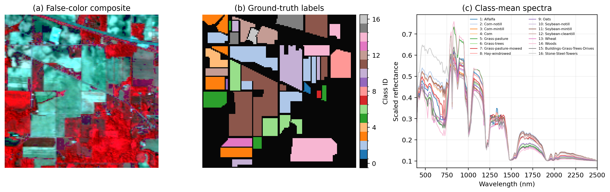

# SpecFusion

Reproducible code for **SpecFusion: A Physics-Guided Framework for Efficient, Interpretable, and Cross-Sensor Hyperspectral Classification**. SpecFusion retains a raw spectral branch, computes 196 named physics-guided descriptors, and concatenates both into a 416-dimensional hybrid representation.



## Architecture

```text
sensor spectra
     │
     ├── wavelength harmonization ── 220-band raw branch ─────┐
     │                                                        ├── 416-D fusion
     └── wavelength-validity mask ── 196-D physics branch ────┘
```

The descriptor dictionary is extracted from the source experiment and includes vegetation, red-edge, water, residue, lignin/cellulose, protein, soil, built-up, continuum-depth, area, slope, and interaction features. All descriptor names are stable and tested for uniqueness.

## Installation

Python 3.10 or newer is required.

```bash
python -m venv .venv
source .venv/bin/activate
pip install -e .
```

For development:

```bash
pip install -r requirements.txt
pytest -q
```

## Quick start

```bash
specfusion --config configs/indian_pines.json --output-dir outputs/indian_pines
```

The command loads 10,249 labeled Indian Pines pixels, harmonizes the source cube to 220 bands, computes the 196 descriptors, evaluates raw/physics/fusion Random Forest models on one shared stratified 70/30 split, and writes:

- `representation_comparison.csv`;
- `indian_pines_overview.png`.

## Verified reference run

| Representation | Features | Accuracy | Macro F1 |
|---|---:|---:|---:|
| Raw spectra | 220 | 0.8699 | 0.8549 |
| Physics descriptors | 196 | 0.8930 | 0.8724 |
| Raw + physics fusion | 416 | 0.8969 | 0.8862 |

The committed snapshot is available at [`results/representation_comparison.csv`](results/representation_comparison.csv). Rounded manuscript values originate from the source experiment; the table above is a fresh rerun with this modular implementation and the same seed/split policy.

## Wavelength validity

`harmonize` returns both interpolated values and a Boolean target-wavelength mask. Out-of-support targets receive numeric zero only as storage; the mask distinguishes them from measured zero reflectance. The current public baseline applies conservative gating: if a sample or shared sensor mask has missing target wavelengths, its entire physics vector is zeroed. This avoids false physical evidence. A future sensor-specific descriptor-support dictionary can relax that policy feature by feature without changing the public interface.

## Layout

```text
configs/           fixed experiment settings
data/              compact Indian Pines source files
assets/            README and manuscript figure
results/           small verified metric snapshot
src/specfusion/    harmonization, descriptors, fusion, evaluation, plotting, CLI
tests/             numerical, mask, alignment, and output tests
outputs/           ignored generated artifacts
```

## Cross-sensor scope

The repository implements harmonization and explicit missing-wavelength handling. The included data and smoke command demonstrate the within-scene Indian Pines result. They do **not** by themselves establish held-out-sensor generalization; that claim requires external datasets, spatially controlled splits, and the source–target evaluation matrix described in the paper.

## Related projects

- [SpecLite](https://github.com/khkim1729/SpecLite) evaluates fourfold spectral reduction.
- [SpecRule](https://github.com/khkim1729/SpecRule) discovers compact, interpretable spectral decision rules.

## License

MIT
